# Project Name
Flawless: Online Makeup Store

## Overview
Flawless, a Bahraini makeup business, has requested an online store to take their sales to another level! On this website, you can look at all their products, place your order, and have it delievered right to your doorstep!
 
## Screenshots
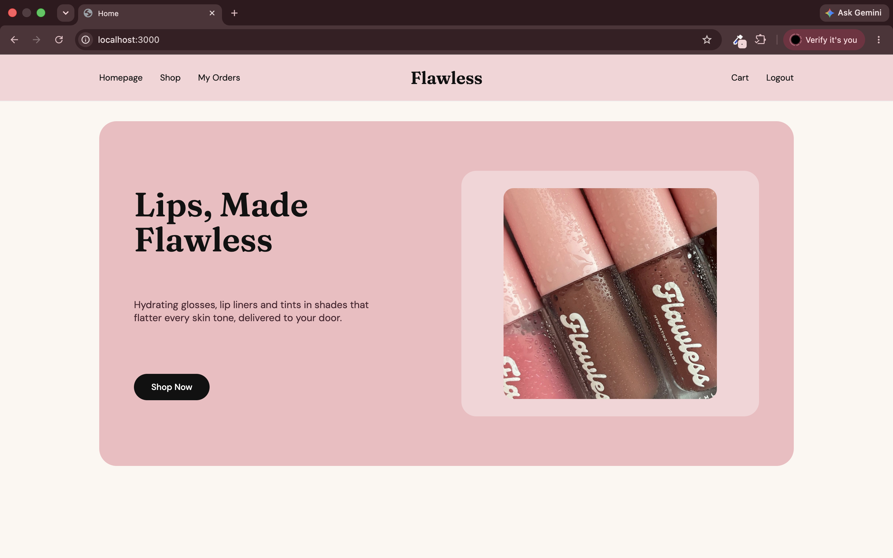
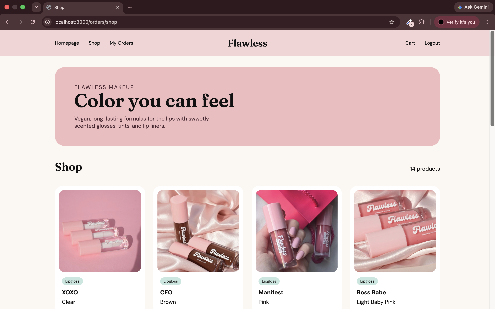
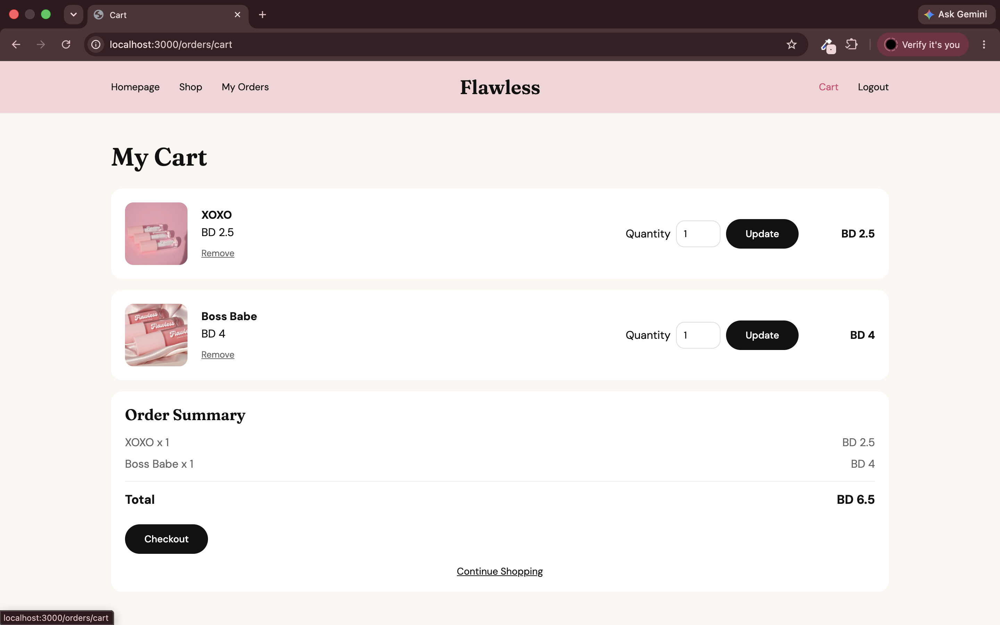
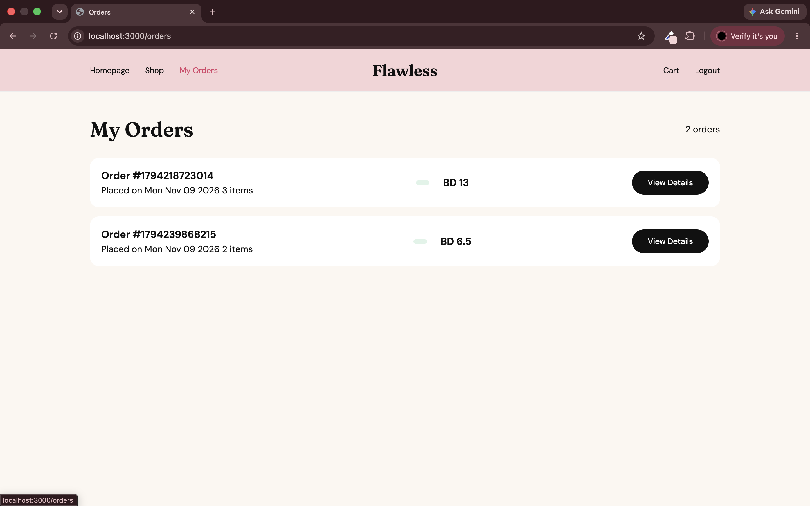
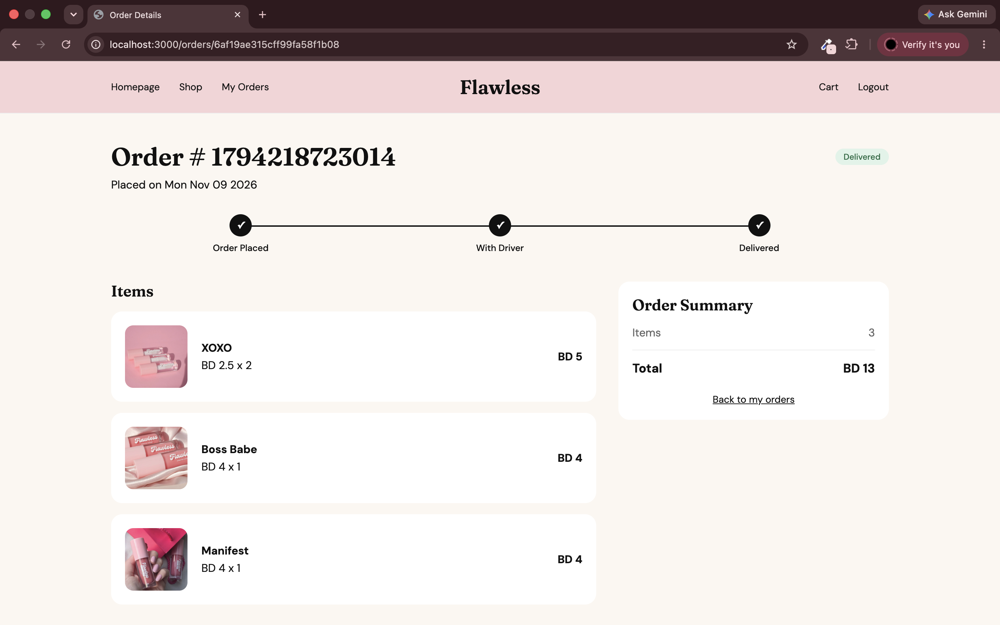
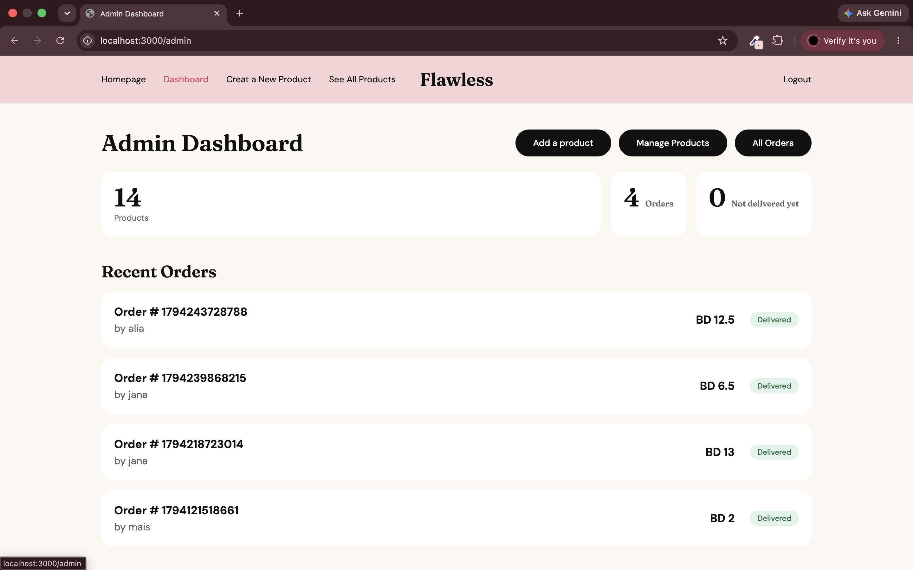
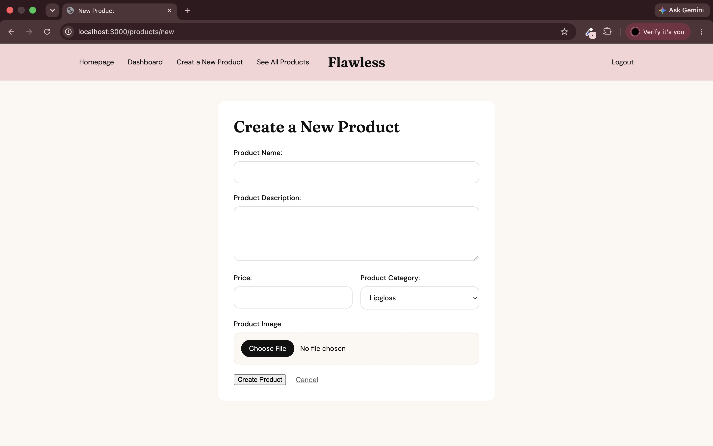
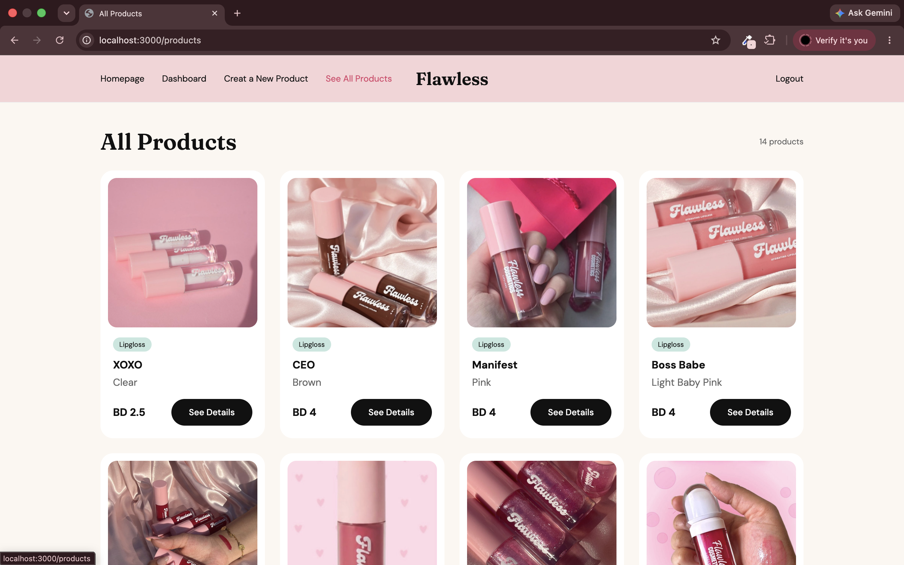
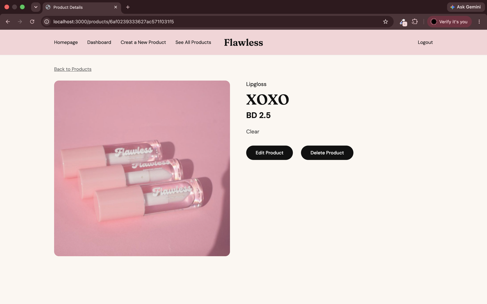
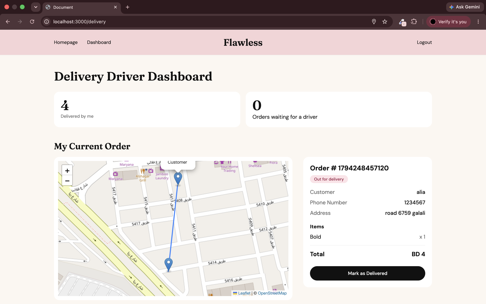


## Technologies Used
MEN Stack: MongoDB, Express, Node.js
HTML, CSS, JavaScript

## Getting Started
1.  Clone the Repository
```
https://github.com/aya-245/flawless-makeup-store
```
2.  cd into the root folder
```
 cd flawless-makeup-store
```
3.  Install dependencies
```
npm install
```
4.  Create a .env file and add the following:
```
MONGODB_URI = <Your DB Connection>
SESSION_SECRET= <Your Session Secret>
PORT=3000
```
5.  Run your website
```
nodemon server.js
```
6.  Search localhost in your browser
```
http://localhost:3000/
```


## User Stories
- The user should be able to signup, login, and logout
- The user should be able to browse all the products
- The user should be able to place an order
- The user should be able to see all their orders
- The user should be assigned one of the 3 roles: Admin, Customer, and Delivery Driver
- The user logged in as admin should be able to see an admin dashboard
- The user logged in as admin should be able to add, update, and delete products
- The user logged in as a delivery driver should be able to see the delivery dashbaord
- The user logged in as a delivery driver should be assigned an order to be delivered

## Database Design
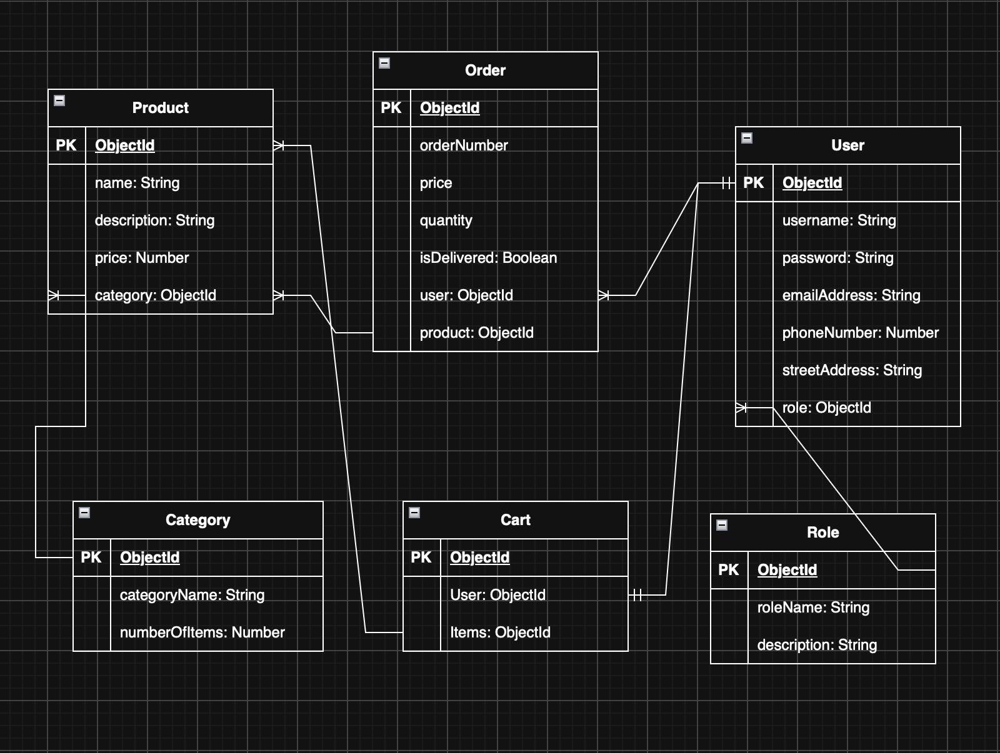


## Routes

Admin Routes
| Method | Route                     | Description                      |
|--------|---------------------------|----------------------------------|
| GET    | /products/new             | New product form                 |
| POST   | /products                 | Create a new product as an admin |
| GET    | /products                 | List all products                |
| GET    | /products/:productId      | View product details             |
| GET    | /products/:productId/edit | Edit product form                |
| PUT    | /products/:productId      | Update product                   |
| DELETE | /products/:productId      | Delete Product                   |


Customer Routes
| Method | Route                       | Description                                   |
|--------|-----------------------------|-----------------------------------------------|
| GET    | /orders/shop                | List all products without login               |
| GET    | /orders/cart                | View cart with total                          |
| POST   | /orders/cart/add/:productId | Add product to cart                           |
| PUT    | /orders/cart/:productId     | Update product quantity in cart               |
| DELETE | /orders/cart/:productId     | Remove product from cart                      |
| POST   | /orders                     | Checkout (create an order and empty the card) |
| GET    | /orders                     | View all my orders                            |
| GET    | /orders/:orderId            | View one of my orders                         |

Admin Dashboard Routes
| Method | Route                  | Description                |
|--------|------------------------|----------------------------|
| GET    | /admin                 | Shows admin dashboard      |
| GET    | /admin/orders          | List all orders            |
| PUT    | /admin/orders/:orderId | Mark an order as delivered |

Delivery Routes
| Method | Route              | Description                                   |
|--------|--------------------|-----------------------------------------------|
| GET    | /delivery          | Shows delivery driver dashboard               |
| POST   | /delivery/next     | Driver can claim the oldest undelivered order |
| PUT    | /delivery/:orderId | Mark one of the assigned orders as delivered  |


## Features
- Full CRUD on User model
- Full CRUD on Order model
- Full CRUD on Cart model
- Full CRUD on Product model
- Admin Dashboard
- Map Functionality
- Photo Upload
- Role Managmenet


## Future Enhancements
1. Payment Gateaway
2. Add exporting stats to pdf or excel feature
3. Add search and filter features
4. Add email confirmation
5. Add toasts


## Credits
1. General information and methods:

https://www.w3schools.com

2. Map functionality

https://leafletjs.com/examples/quick-start/